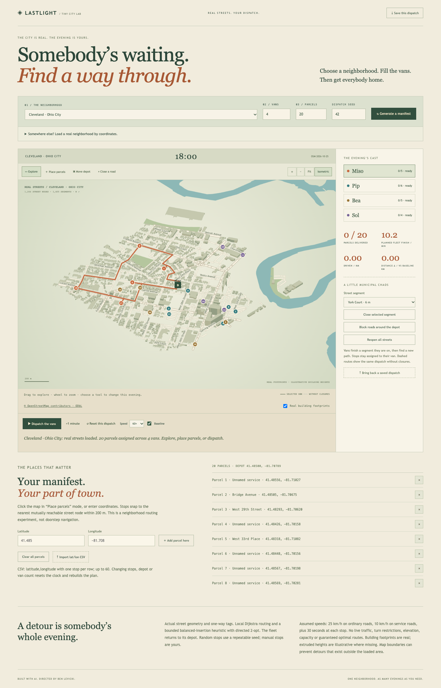
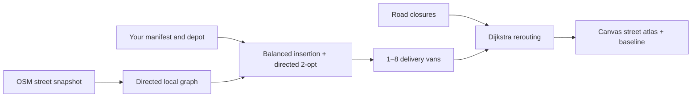

# Tiny City Lab — Lastlight

Real streets. Your parcels. Your fleet. Build a delivery run in a real neighborhood, close a road, and get everybody home.

[Live sandbox](https://bblevick.github.io/tiny-city-lab/) · [50-second walkthrough](docs/media/demo.mp4) · [Specification](SPEC.md) · [Verification](docs/VERIFICATION.md)



Choose Cleveland’s Ohio City, San Francisco’s Mission, or New York’s East Village. Generate **1–60 random delivery stops**, use a repeatable seed, or **place your own parcels** on the map. Set **1–8 vans**, move the depot, and watch street-following routes play out. Vans stop for deliveries and return to the depot. Close individual road segments and compare with the same fleet in an unchanged neighborhood.

Pan, zoom, and switch between an illustrated isometric atlas and north-up view. Street names and building footprints come from real OpenStreetMap snapshots. Extrusion heights are illustrative where height tags are absent. Additional areas can be loaded by center coordinates, in a bounded 1.2 × 1.2 km square. Coordinate CSV import and dispatch JSON export keep the experiment reproducible.

## Run

Node 24 LTS, npm; no API keys. The three bundled neighborhoods work without an external application service.

```sh
npm ci
npm run dev
npm run typecheck
npm test
npx playwright install chromium webkit
npm run test:e2e
npm run build
npm run preview
```

## How the routes work



`src/graph.ts` parses actual OSM ways into directed edges, preserving `oneway=yes`, `oneway=-1`, and roundabout direction. Restricted/private motor access is excluded. Distances come from latitude/longitude. Stops snap to nodes in the largest strongly connected street component, within 200 m. This is a street-node experiment, not address geocoding or doorstep navigation.

`src/city.ts` assigns every stop once using a balanced cheapest-insertion heuristic, followed by bounded directed 2-opt. Routes are estimates, not a proven optimal vehicle-routing solution. Speeds are fixed at 25 km/h on ordinary roads and 10 km/h on service/living streets; each stop takes 30 seconds. No capacity constraints, traffic, turn restrictions, grade, or delivery windows are modeled. Roads outside the downloaded boundary are unavailable. Travel delta is signed: less travel can mean a stranded van, not an improvement.

Closing roads keeps each van’s assigned manifest; a van finishes its current segment and replans its path at the next node. The baseline has identical parcels, fleet, and depot with no closures. Reset keeps the manifest and opens every street. Editing the manifest, depot, or fleet resets the clock. Up to four simulated hours, 500 interventions. Empty vans remain at home.

Scenario JSON version 2 preserves coordinates, fleet, depot, clock, and ordered road changes. Custom scenarios additionally contain the map snapshot, so replay does not fetch a new map. Numerical integration can differ by tiny floating-point rounding; tests compare state within 1e-8. Legacy fictional-city version 1 scenarios are explicitly rejected.

## Source data and privacy

The three original OSM XML extracts, normalized geometry, retrieval URLs, and SHA-256 checksums are in `data/` and `public/cities/`. Refresh intentionally with `python3 scripts/refresh-cities.py` (Python and curl required); this is not a CI or playback step. The map database is © OpenStreetMap contributors under [ODbL 1.0](https://opendatacommons.org/licenses/odbl/1-0/); original application code is [MIT](LICENSE).

Custom-area loading makes an explicit, bounded request to the public OSM map API. Only the selected map bounds are sent; parcel coordinates stay in the browser. Requests are limited to one per 30 seconds, may fail or be too dense, and are not a production map service. No geolocation is requested, no analytics, no map tiles, no routing backend. Export files contain the locations you entered; saving is explicit.

## How this was built with AI

The first version used a fictional 49-node town. Ben’s feedback was direct: “can we have it mirror real cities and real locations?” and “random or user generated parcel delivery spots and # of vans?” That changed the product from a miniature demonstration into a configurable neighborhood dispatch experiment.

Codex implemented the directed graph, original atlas renderer, fleet heuristic, controls, tests, and media. Real data exposed density limits and unavailable Overpass endpoints; bounded OSM extracts replaced the failing source. A replay test exposed insignificant floating-point differences, which are now bounded explicitly rather than called byte-identical. Ben supplied the product direction and judged the original experience insufficient; generated code volume is not the accomplishment.

See [BUILD_LOG.md](BUILD_LOG.md) for actual checks and [TASKS.md](TASKS.md) for bounded handoff tickets. Recreate the actual UI video with `npm run demo:capture` (FFmpeg required).
